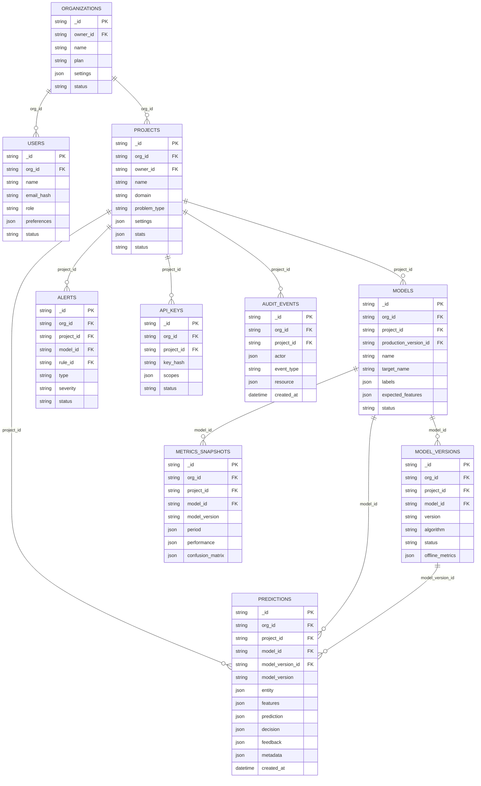

# ModelTrace - Modelo Entidade-Relacionamento

Esta modelagem ER representa relacionamentos logicos entre colecoes documentais. Como o banco e NoSQL, alguns blocos aparecem como atributos `json`: eles sao subdocumentos embutidos e nao tabelas separadas.

Versoes relacionadas:

- JSON simplificado: [`modelagem-json-simplificada.json`](modelagem-json-simplificada.json)
- JSON completo: [`modelagem-json-completa.json`](modelagem-json-completa.json)

## Analise De Correcao

A modelagem original estava correta em manter `predictions` como documento central e em separar historicos que crescem de forma independente, como auditoria, alertas, replays, metricas e caches.

Os ajustes feitos nesta versao:

- incluir todas as 33 colecoes declaradas no backend;
- representar `model_version_id` em `predictions`;
- adicionar as colecoes operacionais e de governanca que estavam ausentes ou subdocumentadas;
- diferenciar dados embutidos em `predictions` de colecoes referenciadas;
- alinhar notificacoes ao campo real `read_at`.

## ER Simplificado

Use este diagrama para apresentacao e explicacao rapida do fluxo principal.

Imagem SVG: [`modeltrace-er-simplificado.svg`](modeltrace-er-simplificado.svg)

## ER Completo

Use este diagrama como referencia tecnica. Ele cobre todas as colecoes atuais do `DocumentStore`.

```mermaid
erDiagram
    ORGANIZATIONS ||--o{ USERS : org_id
    ORGANIZATIONS ||--o{ PROJECTS : org_id
    ORGANIZATIONS ||--o{ API_KEYS : org_id
    ORGANIZATIONS ||--o{ EMAIL_TOKENS : org_id
    ORGANIZATIONS ||--o{ NOTIFICATIONS : org_id
    ORGANIZATIONS ||--o{ JOBS : org_id
    ORGANIZATIONS ||--o{ SAVED_VIEWS : org_id
    ORGANIZATIONS ||--o{ AUDIT_EVENTS : org_id
    ORGANIZATIONS ||--o{ WEBHOOKS : org_id

    USERS ||--o{ EMAIL_TOKENS : user_id
    USERS ||--o{ SAVED_VIEWS : user_id
    USERS ||--o{ ENTITY_NOTES : created_by
    USERS ||--o{ PREDICTION_ANNOTATIONS : user_id
    USERS ||--o{ PREDICTION_REPLAYS : created_by
    USERS ||--o{ JOBS : created_by
    USERS ||--o{ EXPORTS : created_by
    USERS ||--o{ APPROVALS : requested_or_approved_by

    PROJECTS ||--o{ MODELS : project_id
    PROJECTS ||--o{ MODEL_VERSIONS : project_id
    PROJECTS ||--o{ API_KEYS : project_id
    PROJECTS ||--o{ JOBS : project_id
    PROJECTS ||--o{ SAVED_VIEWS : project_id
    PROJECTS ||--o{ ENTITY_NOTES : project_id
    PROJECTS ||--o{ PREDICTIONS : project_id
    PROJECTS ||--o{ METRICS_SNAPSHOTS : project_id
    PROJECTS ||--o| DASHBOARD_CACHE : project_id
    PROJECTS ||--o{ DIAGNOSTIC_CACHE : project_id
    PROJECTS ||--o{ DRIFT_REPORTS : project_id
    PROJECTS ||--o{ ALERT_RULES : project_id
    PROJECTS ||--o{ ALERTS : project_id
    PROJECTS ||--o{ WEBHOOKS : project_id
    PROJECTS ||--o{ WEBHOOK_DELIVERIES : project_id
    PROJECTS ||--o{ DATASETS : project_id
    PROJECTS ||--o{ COHORTS : project_id
    PROJECTS ||--o{ MODEL_EVALUATIONS : project_id
    PROJECTS ||--o{ MODEL_CARDS : project_id
    PROJECTS ||--o{ INTERVENTION_CASES : project_id
    PROJECTS ||--o{ INCIDENTS : project_id
    PROJECTS ||--o{ DATA_QUALITY_REPORTS : project_id
    PROJECTS ||--o{ APPROVALS : project_id
    PROJECTS ||--o{ AUDIT_EVENTS : project_id
    PROJECTS ||--o{ EXPORTS : project_id

    MODELS ||--o{ MODEL_VERSIONS : model_id
    MODELS ||--o{ PREDICTIONS : model_id
    MODELS ||--o{ METRICS_SNAPSHOTS : model_id
    MODELS ||--o{ DIAGNOSTIC_CACHE : model_id
    MODELS ||--o{ DRIFT_REPORTS : model_id
    MODELS ||--o{ ALERT_RULES : model_id
    MODELS ||--o{ ALERTS : model_id
    MODELS ||--o{ MODEL_EVALUATIONS : model_id
    MODELS ||--o{ MODEL_CARDS : model_id
    MODELS ||--o{ INTERVENTION_CASES : model_id
    MODELS ||--o{ APPROVALS : model_id

    MODEL_VERSIONS ||--o{ PREDICTIONS : model_version_id
    MODEL_VERSIONS ||--o{ MODEL_EVALUATIONS : model_version_id
    MODEL_VERSIONS ||--o{ APPROVALS : model_version_id

    PREDICTIONS ||--o{ PREDICTION_ANNOTATIONS : prediction_id
    PREDICTIONS ||--o{ PREDICTION_REPLAYS : prediction_id
    PREDICTIONS ||--o{ PREDICTION_SCENARIOS : prediction_id
    PREDICTIONS ||--o| INTERVENTION_CASES : prediction_id

    DATASETS ||--o{ DATA_QUALITY_REPORTS : dataset_id
    ALERT_RULES ||--o{ ALERTS : rule_id
    ALERTS ||--o{ NOTIFICATIONS : metadata_alert_id
    JOBS ||--o{ NOTIFICATIONS : metadata_job_id
    WEBHOOKS ||--o{ WEBHOOK_DELIVERIES : webhook_id

    ORGANIZATIONS {
      string _id PK
      string owner_id FK
      string name
      string slug
      string plan
      json settings
      string status
      datetime created_at
    }

    USERS {
      string _id PK
      string org_id FK
      string name
      string email_hash
      string email_encrypted
      string password_hash
      string role
      json project_permissions
      json preferences
      string status
      datetime created_at
    }

    PROJECTS {
      string _id PK
      string org_id FK
      string owner_id FK
      string name
      string slug
      string domain
      string problem_type
      string entity_label
      json settings
      json stats
      string status
      datetime created_at
    }

    MODELS {
      string _id PK
      string org_id FK
      string project_id FK
      string production_version_id FK
      string name
      string problem_type
      string target_name
      json labels
      json expected_features
      string status
    }

    MODEL_VERSIONS {
      string _id PK
      string org_id FK
      string project_id FK
      string model_id FK
      string version
      string algorithm
      string status
      json features
      json hyperparameters
      json training_metadata
      json offline_metrics
    }

    API_KEYS {
      string _id PK
      string org_id FK
      string project_id FK
      string created_by FK
      string prefix
      string key_hash
      string hash_algorithm
      json scopes
      string status
    }

    EMAIL_TOKENS {
      string _id PK
      string org_id FK
      string user_id FK
      string purpose
      string token_hash
      string status
      datetime expires_at
      datetime used_at
    }

    NOTIFICATIONS {
      string _id PK
      string org_id FK
      string user_id FK
      string project_id FK
      string type
      string severity
      string title
      json metadata
      datetime read_at
      datetime created_at
    }

    JOBS {
      string _id PK
      string org_id FK
      string project_id FK
      string model_id FK
      string created_by FK
      string type
      string status
      json params
      json result
      string error
    }

    SAVED_VIEWS {
      string _id PK
      string org_id FK
      string user_id FK
      string project_id FK
      string view
      string name
      json filters
      json columns
      json sort
      boolean shared
    }

    ENTITY_NOTES {
      string _id PK
      string org_id FK
      string project_id FK
      string entity_hash
      string created_by FK
      string content
      json tags
      datetime created_at
    }

    PREDICTION_SCENARIOS {
      string _id PK
      string org_id FK
      string project_id FK
      string prediction_id FK
      string created_by FK
      string name
      string mode
      json feature_overrides
      json result
    }

    PREDICTIONS {
      string _id PK
      string org_id FK
      string project_id FK
      string model_id FK
      string model_version_id FK
      string model_version
      json entity
      json features
      json prediction
      json explanations
      json decision
      json feedback
      json annotations
      json flags
      json metadata
      datetime created_at
    }

    PREDICTION_ANNOTATIONS {
      string _id PK
      string org_id FK
      string project_id FK
      string prediction_id FK
      string user_id FK
      string type
      string content
      json tags
      datetime created_at
    }

    PREDICTION_REPLAYS {
      string _id PK
      string org_id FK
      string project_id FK
      string prediction_id FK
      string model_id FK
      string created_by FK
      json original
      json replay
      json hypothetical_features
      boolean decision_changed
    }

    METRICS_SNAPSHOTS {
      string _id PK
      string org_id FK
      string project_id FK
      string model_id FK
      string model_version
      json period
      json counts
      json performance
      json confusion_matrix
      json score_distribution
    }

    DASHBOARD_CACHE {
      string _id PK
      string org_id FK
      string project_id FK
      int cache_version
      int prediction_count
      int alert_count
      json dashboard
      datetime computed_at
    }

    DIAGNOSTIC_CACHE {
      string _id PK
      string org_id FK
      string project_id FK
      string model_id FK
      string slice_feature
      int cache_version
      int prediction_count
      int feedback_count
      json diagnostics
    }

    DRIFT_REPORTS {
      string _id PK
      string org_id FK
      string project_id FK
      string model_id FK
      string model_version
      string status
      json reference_period
      json current_period
      json prediction_drift
      json data_drift
    }

    ALERT_RULES {
      string _id PK
      string org_id FK
      string project_id FK
      string model_id FK
      string created_by FK
      string name
      string type
      string metric
      string operator
      float threshold
      string severity
      boolean enabled
    }

    ALERTS {
      string _id PK
      string org_id FK
      string project_id FK
      string model_id FK
      string rule_id FK
      string type
      string severity
      string status
      string metric
      float observed_value
      float threshold
      datetime created_at
    }

    WEBHOOKS {
      string _id PK
      string org_id FK
      string project_id FK
      string created_by FK
      string name
      string url
      string secret_hash
      json events
      string status
    }

    WEBHOOK_DELIVERIES {
      string _id PK
      string org_id FK
      string project_id FK
      string webhook_id FK
      string event_type
      json resource
      string status
      int attempts
      int last_status_code
      string last_error
    }

    DATASETS {
      string _id PK
      string org_id FK
      string project_id FK
      string name
      string type
      json source_files
      json schema
      int row_count
      int entity_count
      datetime created_at
    }

    COHORTS {
      string _id PK
      string org_id FK
      string project_id FK
      string name
      string type
      json filters
      int size
      int open_cases
      datetime created_at
    }

    MODEL_EVALUATIONS {
      string _id PK
      string org_id FK
      string project_id FK
      string model_id FK
      string model_version_id FK
      string algorithm
      string window
      int rank
      json offline_test_metrics
      json production_simulation
    }

    MODEL_CARDS {
      string _id PK
      string org_id FK
      string project_id FK
      string model_id FK
      string version
      string title
      string intended_use
      string not_for_use
      json known_limitations
      json governance
      json approval
    }

    INTERVENTION_CASES {
      string _id PK
      string org_id FK
      string project_id FK
      string model_id FK
      string prediction_id FK
      string status
      string priority
      int priority_rank
      float risk_score
      string recommended_action
      datetime sla_due_at
      json drivers
      json timeline
    }

    INCIDENTS {
      string _id PK
      string org_id FK
      string project_id FK
      string created_by FK
      string severity
      string status
      string title
      string impact
      string root_cause
      datetime created_at
    }

    DATA_QUALITY_REPORTS {
      string _id PK
      string org_id FK
      string project_id FK
      string dataset_id FK
      json source
      json checks
      json status_counts
      json missingness
      json controls
      json warnings
    }

    APPROVALS {
      string _id PK
      string org_id FK
      string project_id FK
      string model_id FK
      string model_version_id FK
      string requested_by FK
      string approved_by FK
      string title
      string status
      datetime approved_at
    }

    AUDIT_EVENTS {
      string _id PK
      string org_id FK
      string project_id FK
      json actor
      string event_type
      json resource
      json context
      json diff
      datetime created_at
    }

    EXPORTS {
      string _id PK
      string org_id FK
      string project_id FK
      string created_by FK
      string type
      json filters
      string format
      boolean redact_pii
      string status
      string file_path
      int record_count
    }
```

## Observacoes

- Cardinalidades representam referencias logicas, nao chaves estrangeiras fisicas.
- `features`, `prediction`, `decision`, `feedback`, `metadata`, `diagnostics`, `dashboard` e blocos semelhantes sao subdocumentos JSON.
- A colecao `predictions` e otimizada para leitura de uma decisao completa; os historicos de crescimento independente ficam separados.
- `webhooks` e `webhook_deliveries` ja existem no store como colecoes preparadas, mesmo que a interface/API atual ainda nao exponha todo o fluxo.
